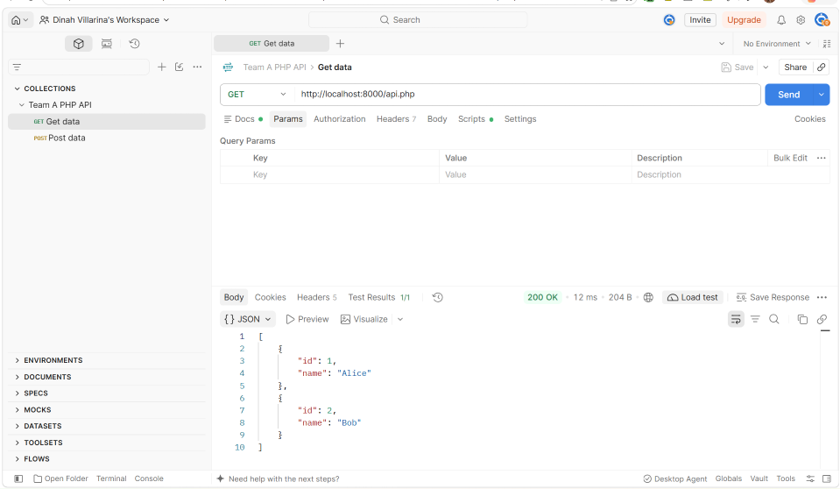
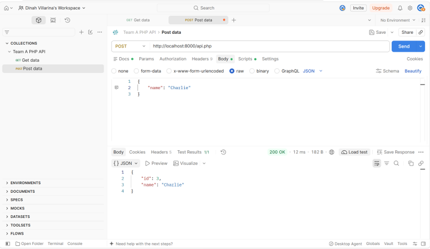
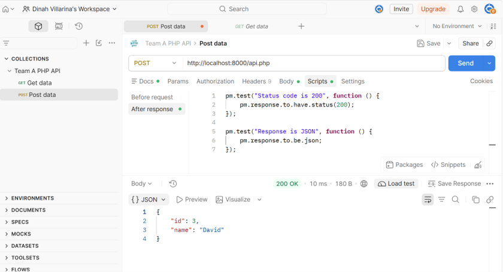
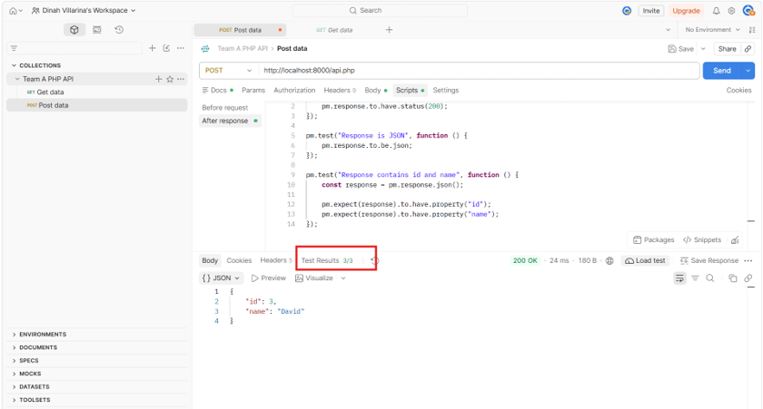

# PHP REST API Laboratory Documentation

**Course:** Programming Tools and Techniques
**Laboratory:** Building, Testing, and Evaluating a PHP REST API with Postman and AI Assistance
**Group:** Individual Activity

---

## 1. Group Information

| Name | Assigned Role |
|---|---|
| VILLARINA, DINAH CHRISHALEI R. | PHP API development, Postman requests and testing, and documentation |

*This activity was completed individually; therefore, both development and testing responsibilities were handled by one student.*

## 2. API Information

The activity used a PHP file named `api.php` to provide two endpoints tested through Postman.

| HTTP Method | Endpoint | Purpose |
|---|---|---|
| GET | `/api.php` | Retrieve the existing user records in JSON format. |
| POST | `/api.php` | Receive a JSON object containing a user's name and return a newly created user record. |

### Test results

- **GET request:** Returned HTTP `200 OK` and a JSON list containing two existing users: Alice (ID: 1) and Bob (ID: 2).
- **POST request:** Sent the name `Charlie` as raw JSON and returned HTTP `200 OK` with the new record containing ID `3` and name `Charlie`.
- **Response format:** JSON.

> **Important limitation:** The starter API stores users in a PHP array initialized inside `api.php`. The array is recreated for each HTTP request, so a user added by one POST request is not permanently saved for later requests. A database such as MySQL would be needed for persistent storage.

## 3. Screenshots

The following screenshots document the GET and POST requests and the Postman test results.

### Successful GET request

### Successful POST request

### Postman test results

### Additional AI-assisted test

## 4. AI Assistance

### AI tool used

ChatGPT & Google Ai

### Prompts used during the activity

1. **Understanding API concepts**
   “I am a student learning REST APIs using PHP and Postman. Explain in simple terms what an API is, what a REST API is, and how GET and POST requests work. Also explain the role of JSON and how Postman helps developers test APIs. Give a simple example but do not complete my laboratory activity for me.”

2. **Understanding the PHP code**
   “Explain the following PHP API code to a beginner. Describe what each important section does, including the Content-Type header, `$users`, `$_SERVER['REQUEST_METHOD']`, `json_encode()`, `json_decode()`, `file_get_contents("php://input")`, and the GET and POST sections. Do not modify the code.”

3. **Analyzing the GET response**
   “I sent a GET request to my PHP REST API using Postman and received the following response. Explain the JSON structure and tell me whether the response appears appropriate for an API that returns a list of users. Do not assume that the API is correct solely because it returned a response.”

4. **Troubleshooting an API error**
   “I am testing a PHP API using Postman. I am receiving the following error or unexpected result: [PASTE ERROR]. Here is the relevant PHP code and Postman configuration: [DETAILS]. Give me possible causes in order of likelihood and tell me what I should check. Do not rewrite the entire program.”

### Useful AI recommendation

AI suggested adding tests that check whether the response contains the required `id` and `name` properties, whether the returned name matches the submitted name, and whether the returned ID is valid. These checks provide more meaningful verification than checking only the HTTP status code and response format. The additional test shown in the Postman screenshot checks that the response contains both `id` and `name`.

### AI response that required verification or further investigation

AI explained that the newly added user would not remain available after a separate request because the `$users` array is initialized again whenever `api.php` processes a new HTTP request. This was important to verify by sending POST and GET requests separately. The investigation showed that the starter API does not permanently store new users. A database, such as MySQL, would be needed to retain user records.

During troubleshooting, AI also suggested checking the request URL after Postman returned `404 Not Found` for `/wrong.php`. The URL was corrected to `http://localhost:8000/api.php`, after which the request could target the existing PHP file.

## 5. Short Conclusion

Through this activity, I learned how to create and test a simple PHP REST API using GET and POST requests in Postman. I also learned how to check API responses using automated tests and why verifying the returned data is important, not just the status code. AI helped explain the PHP code, suggest additional tests, and identify possible causes of errors, but I still needed to test the API and verify its suggestions myself. I also learned that the starter API does not permanently save new users because it does not use a database.
